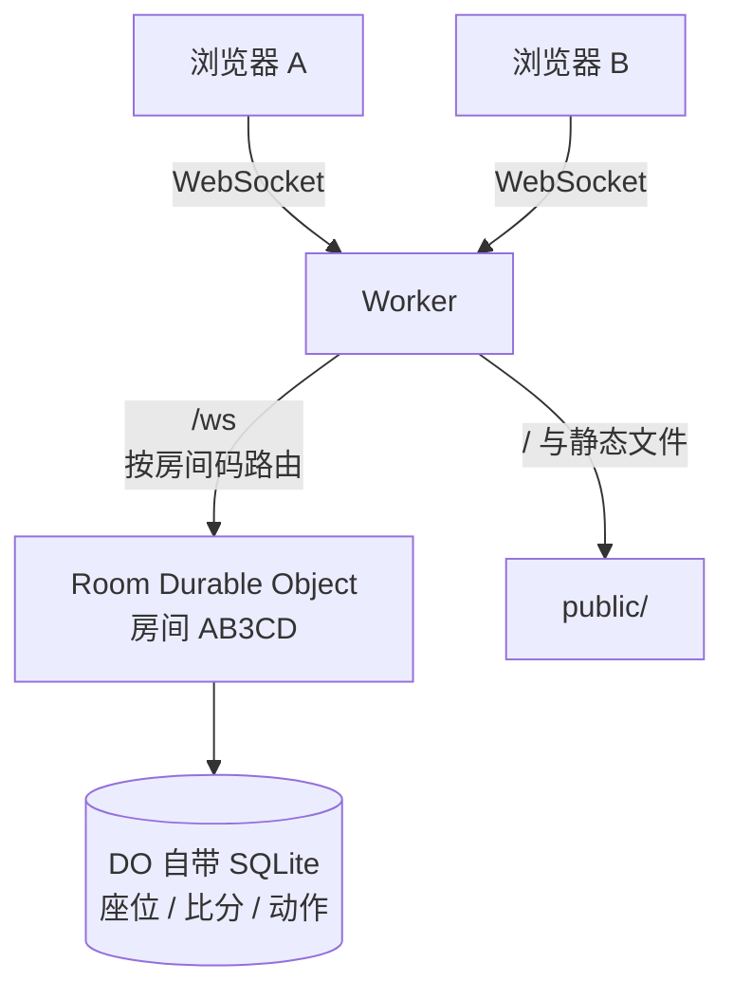

# 回合制联机小游戏套件

**给"想和朋友联机玩自己做的小游戏"的人一个能跑的起点。**

克隆 → 部署 → 把链接发出去，五分钟内就能和朋友打一局。
然后改一个文件，把它变成你自己的游戏。


[](https://github.com/gcx91224-ai/turn-based-online-kit/actions/workflows/ci.yml)

demo 是"石头剪刀布，先赢 3 局"。它的作用是**证明整条链路是通的**：

- 建一个房间，拿到 5 位房间码
- 把 `/r/AB3CD` 这样的链接发给朋友
- 两人同时出招，服务器收齐才公开
- 刷新不掉线，断线能重连
- 先到 3 分结束，两人都点「再来一局」才重开

---

## 这个套件解决什么问题

你可能已经试过：写了个单机网页游戏，想加联机，然后发现——

- 要买服务器、配域名、搞 HTTPS
- WebSocket 断线要重连，重连要恢复状态
- 两个人同时出招，怎么防止对方看到我的选择再改
- 刷新一下座位就没了
- 部署完邀请链接打不开，或者打开是白板

这些都不是"游戏玩法"的问题，但每一个都能让项目卡住一周。

这个仓库把这些问题都填过一遍，留下一个**最小可运行的骨架 + 一份踩坑记录**。
你可以直接用它，也可以只读文档，然后自己搭。

### 它给你

- ✅ 一个真能玩的联机 demo（无框架、无构建、无数据库）
- ✅ 房间 / 座位 / 重连 / 超时 / 结算的完整实现
- ✅ 每个关键决定背后的取舍（为什么不一开始就用 Socket.io）
- ✅ 16 条真实踩过的坑，带症状和定位方法
- ✅ 不启动 Cloudflare 本地运行时也能跑的服务端测试
- ✅ **可选模块**：好友、排位分、排行榜、匹配队列 —— `extras/` 里有实现和测试，默认不启用

### 它不给你

- ❌ 实时动作游戏（60fps 同步需要另一套）
- ❌ 真正的账号系统（邮箱 / 第三方登录）。现在只有"设备 token"，
     分数和好友都挂在它上面，清缓存就没了
- ❌ 公开房间列表（朋友局靠房间码；要做的话看 [09](docs/09-limits.md)）

---

## 快速开始

```bash
git clone <你的仓库地址>
cd turn-based-online-kit
npm install
npx wrangler login
npm run dev
```

打开 `http://localhost:8787`，用**两个不同的浏览器**（或一个正常 + 一个无痕）测试。
同一个浏览器的两个标签页会共享 localStorage 里的 token，被认成同一个人。

部署：

```bash
npm run deploy
```

拿到 `https://xxx.workers.dev` 就能发给朋友了。详细步骤和验证清单见
[06 · 部署](docs/06-deploy.md)。

---

## 它是怎么跑的



- **一个房间 = 一个 Durable Object 实例**：状态天然隔离，消息串行处理，不用加锁
- **服务器是权威**：客户端只发"我出石头"，胜负由服务器算
- **两端同时出招**：服务器收齐才公开，任何人看不到对方的选择
- **静态文件不走脚本**：`game/` 直出，不占请求额度

---

## 目录

```
worker/
  index.js      Worker 路由：静态文件 / 建房 / WebSocket / 邀请链接
  room.js       ★ 房间 DO：座位、回合、超时、重连、视图裁剪
  game.js       ★ 你的游戏规则（换游戏只改这里）
  protocol.js   房间码、名字、token 的纯函数校验
public/
  index.html    首页 / 房间 / 对局，全部在这一个页面里切
  app.js        连接管理 + 渲染（无框架）
  style.css
extras/               可选模块，默认不部署（启用方式见 wrangler.jsonc 注释）
  players.js    名册 DO：昵称/头像/好友/排位分/排行榜
  ladder.js     匹配队列 DO：分数接近的人撮合进普通房
tests/
  room.test.mjs       ★ 用假 DO 环境跑完整对局
  worker.test.mjs     路由：建房 / 邀请链接 / WebSocket 转发
  extras.test.mjs     好友、分数、排行、撮合
  game.test.mjs       规则全组合
  protocol.test.mjs   房间码与输入校验
docs/                 九篇文档，从选型到部署
```

---

## 换成你自己的游戏

**只换判定**：改 `worker/game.js` 的三个导出即可，房间流程一行都不用动。

```js
export const MOVES = ['rock', 'paper', 'scissors'];
export const isValidMove = (m) => MOVES.includes(m);
export const resolve = (a, b) => 'A' | 'B' | 'draw';
```

**有血量、手牌、隐藏信息**：看 [04 · 换成你自己的游戏](docs/04-swap-your-game.md)，
那里讲了状态放哪、结算怎么写、以及**视图裁剪**——这是唯一一个改错就会让游戏失去公平性的地方。

**想改成交替回合（井字棋、象棋）**：同一篇文档的最后一节。

---

## 设计上做对的四件事

这四条是这套东西的核心，换游戏时尽量别改坏。

### 1. 客户端只发意图，服务器算结果

```js
// 客户端：我出石头
ws.send(JSON.stringify({ type: 'pick', move: 'rock' }));
```

胜负、比分、下一轮是谁，全在服务器。前端改代码没用，因为服务器不认。

### 2. 收齐才公开，而且只认第一条

```js
if (st.picks[seat]) return;      // 出过了，后面的一律忽略
st.picks[seat] = msg.move;
// 广播时：自己的 pick 可以给，对方的只给「出没出」
```

防的是同时出招游戏里最经典的两种作弊：**看到对方没出再改**、**抓包偷看**。

### 3. 状态落盘，超时用 alarm

Durable Object 会休眠，`setTimeout` 和内存变量都会消失。
状态进 `storage`，定时用 `setAlarm` —— 这样 DO 睡一觉醒来还能接着打。

### 4. 重连靠 token 找回座位

token 存在浏览器里，服务器按它认人。刷新、断网、切后台回来，还是那个座位。
**这不是账号系统**，只是"这台设备是谁"。

---

## 文档

| 文档 | 内容 |
|---|---|
| [01 · 先选架构](docs/01-architecture.md) | 权威服务器 / 确定性锁步 / P2P，怎么选 |
| [02 · 房间与身份](docs/02-room-and-identity.md) | 房间码设计、设备 token、重连、邀请链接的两个坑 |
| [03 · 回合与公平性](docs/03-turns-and-fair-play.md) | 状态机、视图裁剪、承诺-揭示什么时候才需要 |
| [04 · 换成你的游戏](docs/04-swap-your-game.md) | 规则替换、额外状态、多人、交替回合 |
| [05 · 连接与重连](docs/05-transport.md) | 心跳、僵尸连接、可靠队列、DO 的 WebSocket 两套 API |
| [06 · 部署](docs/06-deploy.md) | 从登录到自定义域，含免费额度算账与验证清单 |
| [07 · 踩坑清单](docs/07-pitfalls.md) | 16 条：症状 → 原因 → 解法 |
| [08 · 测试](docs/08-testing.md) | 没有本地运行时，怎么测服务端 |
| [09 · 限制与扩展](docs/09-limits.md) | 多人、观战、房间列表、什么时候该换技术栈 |
| [10 · 身份、好友与权限](docs/10-identity-and-social.md) | 三层身份、短号、好友模型、房主移交 |
| [11 · 排位与匹配](docs/11-rank-and-match.md) | 分数模型、撮合算法、结算归属、排行榜脱敏 |

---

## 测试

```bash
npm test     # 52 个断言，不需要网络、不需要 Cloudflare 运行时
npm run check
```

测试用假 Durable Object 环境直接驱动 `room.js` 和 `index.js`，覆盖：

- 两人到齐自动开局
- **对方未公开的动作不会出现在我的视图里**
- 先出 rock 再出 paper，按 rock 结算
- 满员拒绝、重连坐回原位、超时自动推进、状态落盘
- **邀请链接内部请求的是 `/` 而不是 `/index.html`**（这条错了邀请链接就废了）
- 好友加/删/重复请求只会产生一条、互相请求直接成交、列表不泄漏完整 token
- 分数 ±10、没报到过的身份不写分、排行榜过滤场次与脱敏
- 撮合窗口、等待放宽、取消、超时清理

---

## 常见问题

**必须用 Cloudflare 吗？**

不必须，但这是最省事的。房间层只依赖 `ctx.storage`、`acceptWebSocket`、`setAlarm`
三个 API，迁到 Node + `ws` 大约一两天。

**免费吗？**

朋友局用不完免费额度。一局约 20-30 个请求，静态文件不计费。
数字会变，以 Cloudflare 官方 pricing 为准。

**能支持多少人？**

默认 2 人。改 `SEATS` 可以更多人，但结算逻辑要支持"多人同时结算"，
见 [04](docs/04-swap-your-game.md#多人3-4-人)。

**能做实时动作游戏吗？**

不能。这套是回合制模型。实时同步需要客户端预测 + 服务器 tick，是另一套东西。

**为什么不用 Socket.io / Colyseus？**

它们需要一台常驻服务器。这个项目的目标是"零运维、零成本、发个链接就能玩"，
所以选了 Serverless + Durable Object。如果你的项目已经有一台 Node 服务器，
用 Socket.io 完全没问题，文档里的房间/公平性/重连思路一样适用。

**为什么 demo 是猜拳？**

因为它不需要解释规则。你打开就能玩，从而把注意力放在"联机通不通"上，
而不是"这游戏怎么玩"。

---

## 贡献

修 bug、补一条踩坑记录都欢迎。规则很短，见 [CONTRIBUTING.md](CONTRIBUTING.md)。

## License

MIT。拿去改，不用问我。
